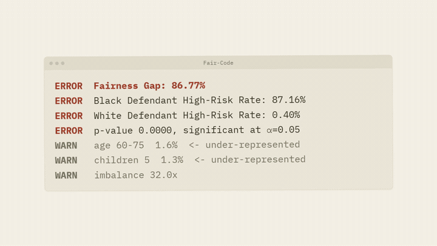

<div align="center">

# Fair Code - Algorithmic Bias Detection & Mitigation

*AI systems are making decisions about your freedom, your job, and your healthcare. This project shows the bias is real - and how to fix it.*

**by [Yash Kewlani](https://github.com/yakew7) · [@thefaircodeproject](https://www.instagram.com/thefaircodeproject)**

[🌐 Live website](https://www.thefaircode.xyz) · [📓 Notebooks](#projects) · [🧠 Explainers](#explainers) · [🤝 Contribute](CONTRIBUTING.md)

<p align="center"></p>


<a href="https://github.com/yakew7/Fair-Code/stargazers"></a>
<a href="https://github.com/yakew7/Fair-Code/forks"></a>
<a href="https://github.com/yakew7/Fair-Code/watchers"></a>
<a href="https://github.com/yakew7/Fair-Code/contributors"></a>

</div>

---

## Contents

- [What This Is](#what-this-is)
- [Results at a Glance](#results-at-a-glance)
- [Healthcare AI Bias Focus](#healthcare-ai-bias-focus)
- [Repository Structure](#repository-structure)
- [Projects](#projects)
- [Explainers](#explainers)
- [Methodology](#methodology)
- [Why This Matters](#why-this-matters)
- [Getting Started](#getting-started)
- [Open Dataset Profiler](#open-dataset-profiler)
- [Benchmark Harness](#benchmark-harness)
- [Reproducibility & Results History](#reproducibility--results-history)
- [Tech Stack](#tech-stack)
- [Traction](#traction)
- [Contributors](#contributors)
- [What's Next](#whats-next)
- [Roadmap](#roadmap)
- [Website](#website)
- [Connect](#connect)

---

## What This Is

Fair Code is an ongoing research and engineering project that exposes bias in real-world AI systems and demonstrates concrete mitigation strategies.

Every audit follows the same pipeline:

```
train a biased model → measure the fairness gap → engineer a fair model → measure again
```

No theory. No hand-waving. Just data, code, and results.

Each audit ships as both a pair of Python scripts (`unfair.py` / `fair.py`) for direct execution and a Jupyter notebook (`notebooks/`) that walks through the full pipeline step by step - with visualisations, proxy detection, and annotated findings.

---

## Results at a Glance

| # | Domain | Protected Attribute | Proxies Removed | Gap Before → After | Reduction |
|:-:|--------|--------------------|-----------------|--------------------|:---------:|
| 01 | [Criminal Justice](#01--compas--criminal-justice-bias) | Race | Custody Status | 86.77% → 15.69% | **82%** |
| 02 | [Hiring](#02--ai-fair-recruitment--hiring-bias) | Gender | Age | 4.03% → 0.16% | **96.1%** |
| 03 | [Lending](#03--german-credit-lending--lending-bias) | Age | Employment Tenure | 7.16% → 1.89% | **73.6%** |
| 04 | [Healthcare](#04--insurance-denial--healthcare-bias) | Age, Gender | BMI, Smoker, Diabetic | Age: 7.93% → 3.18% | **60%** |
| ↳  | | | | Gender: -5.44% → +1.54% | direction flips |
| 05 | [Welfare](#05--benefits-denial--welfare-eligibility-bias) | Sex, Race, Origin, Age | Relationship, Marital Status, Hours, Occupation, fnlwgt | Sex: 18.00% → 8.52% | **53%** |
| ↳  | | | | Race: 12.75% → 6.90% | **46%** |
| ↳  | | | | Origin: 4.40% → 0.52% | **88%** |
| ↳  | | | | Age: -2.72% → -2.79% | **+3% ↑** |
| 06 | [Healthcare Readmission](#06--healthcare-readmission--clinical-bias) | Race, Gender, Age | Payer Code, Discharge Disposition, Medical Specialty, Prior Inpatient | Gender: -0.02% → +0.04% | direction flips |
| ↳  | | | | Race: 0.08% → 0.06% | **25%** |
| ↳  | | | | Age: 0.28% → 0.09% | **68%** |
| 07 | [Tenant Screening](#07--tenant-screening--rental-application-bias) | Race | Prior Arrest/Conviction Episodes, Gang Affiliated, Residence Changes | Race: 6.68% → 5.16% | **23%** |

---

## Healthcare AI Bias Focus

Fair Code has a particular focus on bias in healthcare AI - because the consequences there are not financial or professional. They are clinical.

Three of the seven audits are healthcare or welfare-system models. Each demonstrates the same pattern: an algorithm trained on historical health data learns to penalise patients not for their medical risk, but for the structural inequalities baked into their access to care.

**Key healthcare audits:**

- **[Insurance Denial](Insurance%20Denial/)** - An insurance model uses BMI, smoking status, and diabetes status as proxies for race and class, flagging older and female patients for high-cost claims at elevated rates unrelated to actual medical risk.
- **[Benefits Denial](Benefits%20Denial/)** - An automated welfare means-test flags men for ineligibility at 18 percentage points higher than women - not because of income, but because of who they are married to.
- **[Healthcare Readmission](Healthcare%20Readmission/)** - A hospital readmission model flags patients for high clinical risk using payer code and discharge destination - variables that measure insurance access, not medical severity.

**Published healthcare AI explainers:**

- [Why Accuracy Is Not Enough in Healthcare AI](explainers/accuracy-not-enough-healthcare-ai.md) - why a 95% accurate model can still systematically miss high-risk patients from specific demographic groups
- [False Positives vs. False Negatives in Medical Risk Models](explainers/false-positives-vs-false-negatives.md) - how the direction of error matters, and why false negatives cluster in historically undertreated groups
- [Miscalibration in Clinical Risk Scores Across Groups](explainers/clinical-score-miscalibration.md) - why a risk score well-calibrated on average can still mean a different real-world risk depending on the patient's group
- [Missing Data as Bias in Electronic Health Records](explainers/missing-data-bias-ehr.md) - why unequal access to care turns into unequal missingness, and how naive imputation makes it worse
- [Why Medical Imaging Models Fail on Underrepresented Groups](explainers/medical-imaging-representation-gaps.md) - representation gaps and shortcut learning on device/site artifacts in dermatology, radiology, and retinal imaging models
- [Underdiagnosis Bias in Healthcare AI](explainers/underdiagnosis-bias.md) - why historical gaps in diagnostic testing cause ground-truth labels to under-count active disease in underserved groups
- [Race Correction in Clinical Algorithms](explainers/race-correction-clinical-algorithms.md) - why race-adjusted clinical formulas (eGFR, spirometry, VBAC) bake bias into the math and delay care for minority patients
- [The Obermeyer Case: When Cost Becomes a Proxy for Health Need](explainers/obermeyer-cost-proxy.md) - why predicting healthcare spending instead of illness systematically under-refers sicker Black patients

This directly connects Fair Code to the broader responsible AI in healthcare conversation - where CardioAI, clinical risk scores, and insurance triage tools are increasingly making consequential decisions without demographic audits.

---

## Repository Structure

<details>
<summary><strong>Show the full directory tree →</strong></summary>

```
Fair-Code/
│
├── .github/
│   ├── ACTIONS-AUDIT.md
│   ├── CODEOWNERS
│   ├── DEAD-FILE-AUDIT.md
│   ├── PULL_REQUEST_TEMPLATE.md
│   ├── dependabot.yml
│   ├── codeql/
│   │   └── codeql-config.yml
│   ├── ISSUE_TEMPLATE/
│   │   ├── bug_report.yml
│   │   ├── config.yml
│   │   ├── new_audit.yml
│   │   ├── new_explainer.yml
│   │   └── tooling.yml
│   └── workflows/
│       ├── audits.yml                   # CI: runs all audit scripts on every push/PR
│       ├── benchmark-diff.yml           # opt-in: reruns the benchmark on a lockfile-bump PR and comments the diff
│       ├── build-explainers.yml         # rebuilds explainer HTML/JS/OG images, checks they're current
│       ├── citation.yml                 # validates CITATION.cff
│       ├── codeowners-access.yml        # weekly: catches a CODEOWNER whose repo access has lapsed
│       ├── codeql.yml                   # CodeQL static analysis
│       ├── favicons.yml                 # regenerates favicons from logo.svg, checks they're current
│       ├── first.interaction.yml        # Greets first-time issue/PR contributors
│       ├── lint.yml                     # em-dash / broken-links / ruff checks
│       ├── pr-review-ping.yml           # comments @-mentioning CODEOWNERS on every new PR
│       └── validate-workflow.yml        # YAML-lints every file in this workflows/ folder
│
├── COMPAS/                              # each audit folder has the same structure:
│   ├── unfair.py                        #   biased model
│   ├── fair.py                          #   mitigated model
│   ├── audit.yaml                       #   declarative manifest - read by the benchmark harness
│   ├── *.csv                            #   dataset
│   ├── unfair.png                       #   terminal output - biased results
│   └── fair.png                         #   terminal output - mitigated results
├── AI Fair Recruitment/
├── German Credit Lending/
├── Insurance Denial/
├── Benefits Denial/
├── Healthcare Readmission/
├── Tenant Screening/
│
├── notebooks/
│   ├── 01_compas_bias_audit.ipynb
│   ├── 02_hiring_bias_audit.ipynb
│   ├── 03_german_credit_bias_audit.ipynb
│   ├── 04_insurance_denial_bias_audit.ipynb
│   ├── 05_benefits_denial_bias_audit.ipynb
│   ├── 06_healthcare_readmission_bias_audit.ipynb
│   ├── 07_intersectional_bias_audit.ipynb
│   └── 08_tenant_screening_bias_audit.ipynb
│
├── faircode/                            # Open Dataset Profiler + benchmark harness
│   ├── SPEC.md                          #   profiler analysis spec, shared with the web port
│   ├── MANIFEST_SPEC.md                 #   audit.yaml schema for the benchmark harness
│   ├── __init__.py
│   ├── __main__.py                      #   `python -m faircode` entry point
│   ├── detect.py                        #   demographic column auto-detection
│   ├── profiler.py                      #   core representation engine (pure pandas)
│   ├── compare.py                       #   two-dataset representation drift (PSI)
│   ├── proxy.py                         #   chi-squared proxy hints (scipy, opt-in)
│   ├── significance.py                  #   fairness-gap CI + permutation test
│   ├── report.py                        #   terminal / JSON / HTML rendering
│   ├── manifest.py                      #   loads + validates audit.yaml manifests
│   ├── loaders.py                       #   CSV/Excel/JSON dataset loading
│   ├── loaders_extra.py                 #   loader edge cases (mixed types, inconsistent keys)
│   ├── strategies.py                    #   S0-S4 mitigation strategies (incl. fairlearn S3/S4)
│   ├── models.py                        #   the 3 model families, fixed hyperparameters + seed
│   ├── metrics.py                       #   6 fairness metrics + accuracy/AUC/F1
│   ├── benchmark.py                     #   orchestrator - manifests → strategies → metrics → tables
│   ├── figures.py                       #   renders results_fairness.csv → figures/*.png (300 dpi)
│   ├── cli.py                           #   `faircode profile` / `compare` / `benchmark` entry point
│   ├── sample_data.py                   #   bundled demo dataset for `--sample`, shared with the web profiler
│   ├── mcp_server.py                    #   `faircode-mcp` entry point - 6 MCP tools (SPEC.md section 11)
│   ├── provenance.py                    #   dataset SHA-256 + resolved-params block for --json/--html exports
│   ├── _explainers/                     #   generated mirror of explainers/*.md, for the MCP tools
│   ├── _results_frozen/                 #   generated mirror of paper/results-frozen/*.csv, for the MCP tools
│   └── _results_current/                #   generated mirror of results/*.csv, for get_benchmark_results(source="current")
├── tests/
│   ├── fixtures/                        #   sample datasets for loader/edge-case tests
│   ├── test_benchmark.py                # end-to-end benchmark harness tests
│   ├── test_benchmark_dashboard.py      #   benchmark.html's client-side results explorer
│   ├── test_build_explainers.py         #   explainer HTML/JS generation
│   ├── test_check_generated_files_current.py  #   validates the generated-files-current check itself
│   ├── test_cli.py                      #   CLI subcommand tests
│   ├── test_codeowners.py               #   validates .github/CODEOWNERS syntax
│   ├── test_compare.py                  #   drift / comparison tests
│   ├── test_declared_dependencies.py    #   every import is declared in pyproject.toml
│   ├── test_dependency_versions.py      #   requirements-lock.txt pins meet pyproject.toml floors
│   ├── test_figures.py                  #   results_fairness.csv -> figures/*.png rendering
│   ├── test_freeze_paper_results.py     #   results/ -> paper/results-frozen/ snapshot script
│   ├── test_diff_results.py             #   results/ vs snapshot diff script
│   ├── test_generate_images.py          #   favicon / OG-image generation
│   ├── test_js_category_keys.py         #   JS/Python dimension-category key parity
│   ├── test_js_parity_*.py              #   JS profiler engine mirrors the Python one (profile, proxy, held-out, provenance, exports, compare, keywords, CLI command); js_helpers.py is shared
│   ├── test_json_edge_cases.py
│   ├── test_loaders.py
│   ├── test_manifest.py                 #   audit.yaml validation
│   ├── test_mcp_server.py               #   MCP tool tests
│   ├── test_metrics.py                  #   the 6 fairness metrics
│   ├── test_models.py                   #   the 3 model families
│   ├── test_profiler.py                 #   pytest suite for the profiler
│   ├── test_provenance.py               #   provenance-block tests
│   ├── test_proxy.py                    #   proxy-hint tests (scipy)
│   ├── test_render_terminal_png.py      #   terminal-PNG rendering
│   ├── test_report.py
│   ├── test_significance.py             #   significance-module tests
│   ├── test_strategies.py
│   └── test_xlsx_edge_cases.py
├── results/                              # `faircode benchmark` output - LIVE, changes on every rerun
│   ├── results_fairness.csv
│   ├── results_performance.csv
│   ├── summary.csv
│   └── figures/*.png
├── paper/
│   └── results-frozen/                  # kept reference snapshot from an earlier analysis pass
│       ├── MANIFEST.md                  #   git commit, package versions, exact audit.yaml list
│       ├── results_fairness.csv
│       ├── results_performance.csv
│       ├── summary.csv
│       ├── requirements-lock.txt
│       └── figures/*.png
├── brag-output/                          # generated launch-video assets (composition, fonts, SFX/music) - not project docs; sources and licences in ASSETS.md
│   └── composition/**
├── scripts/
│   ├── build_explainers.py              # regenerates explainer HTML/JS/sitemap from the JSON source
│   ├── check_broken_links.py            #   flags dead in-repo markdown links/anchors (make lint)
│   ├── check_em_dash.py                 #   flags em dashes in tracked source/prose (make lint)
│   ├── check_issue_refs.py              #   ROADMAP/CHANGELOG issue numbers vs GitHub (make lint, needs gh)
│   ├── generate_key_fold.py             #   regenerates / verifies the JS case-folding table (make key-fold, key-fold-check)
│   ├── check_explainer_count.py         #   verifies every "N explainers" mention matches explainers/*.md
│   ├── check_generated_files_current.py #   verifies build_explainers.py output is up to date
│   ├── engine-js.js                     #   Node harness for the JS profiler parity tests
│   ├── freeze_paper_results.py          #   snapshots results/ -> paper/results-frozen/
│   ├── diff_results.py                  #   diffs results/ against the paper/results-frozen/ snapshot
│   ├── generate_favicons.py
│   ├── generate_og_images.py            #   renders the 1200x630 OG share images
│   ├── parse-json-js.js
│   └── render_terminal_png.py           #   renders captured stdout as a terminal-style PNG
├── pyproject.toml                       # packages the `faircode` console script
│
├── explainers/
│   ├── proxy-variables.md
│   ├── equalized-odds.md
│   ├── sampling-bias.md
│   ├── shap-values.md
│   ├── disparate-impact.md
│   ├── disparate-treatment.md
│   ├── fairness-metric-conflicts.md
│   ├── calibration.md
│   ├── demographic-parity.md
│   ├── feedback-loop-bias.md
│   ├── label-bias.md
│   ├── individual-fairness.md
│   ├── counterfactual-fairness.md
│   ├── neural-networks.md
│   ├── ai-hallucinations.md
│   ├── reinforcement-learning.md
│   ├── proxy-entanglement.md
│   ├── ml-bias.md
│   ├── data-leakage.md
│   ├── how-ai-detects-patterns.md
│   ├── distribution-shift.md
│   ├── ai-objectivity-myth.md
│   ├── confounding-variable.md
│   ├── predictive-parity.md
│   ├── false-positives-vs-false-negatives.md
│   ├── supervised-learning.md
│   ├── unsupervised-learning.md
│   ├── model-drift.md
│   ├── selection-bias.md
│   ├── automation-bias.md
│   ├── roc-curve-auc.md
│   ├── class-imbalance.md
│   ├── bias-variance-tradeoff.md
│   ├── confusion-matrix.md
│   ├── protected-attribute.md
│   ├── accuracy-not-enough-healthcare-ai.md
│   ├── clinical-score-miscalibration.md
│   ├── missing-data-bias-ehr.md
│   ├── medical-imaging-representation-gaps.md
│   ├── obermeyer-cost-proxy.md
│   ├── underdiagnosis-bias.md
│   ├── race-correction-clinical-algorithms.md
│   ├── reject-inference.md
│   ├── base-rate-fallacy.md
│   ├── precision-recall-curve.md
│   ├── equal-opportunity.md
│   ├── intersectional-bias.md
│   ├── accuracy-equality.md
│   ├── bootstrap-confidence-intervals.md
│   ├── mitigation-strategies.md
│   ├── fairness-through-unawareness.md
│   ├── lime.md
│   ├── counterfactual-explanation.md
│   ├── multiple-comparisons.md
│   ├── fairness-accuracy-tradeoff.md
│   ├── treatment-equality.md
│   ├── conditional-demographic-parity.md
│   ├── differential-privacy.md
│   ├── reject-option-classification.md
│   ├── simpsons-paradox.md
│   ├── subgroup-fairness.md
│   ├── algorithmic-recourse.md
│   ├── maxmin-fairness.md
│   ├── distributionally-robust-optimization.md
│   ├── fairness-in-ranking.md
│   ├── reweighing.md
│   ├── group-specific-thresholds.md
│   ├── permutation-test-fairness-gaps.md
│   ├── adversarial-debiasing.md
│   ├── fairness-regularization.md
│   ├── fair-representation-learning.md
│   ├── measurement-bias.md
│   ├── aggregation-bias.md
│   ├── survivorship-bias.md
│   ├── disaggregated-evaluation.md
│   ├── leave-one-group-out-evaluation.md
│   ├── choosing-a-fairness-metric.md
│   ├── model-cards.md
│   ├── datasheets-for-datasets.md
│   ├── algorithmic-impact-assessment.md
│   ├── inferring-protected-attributes.md
│   ├── fairness-without-demographics.md
│   ├── adverse-action-notices.md
│   ├── geographic-proxies-and-redlining.md
│   ├── risk-based-pricing-gaps.md
│   ├── race-in-clinical-models.md
│   ├── utilization-as-a-label.md
│   ├── discharge-leakage-in-readmission-models.md
│   ├── seed-and-split-sensitivity.md
│   ├── cross-validation-for-fairness.md
│   ├── stratified-test-sets-for-fairness.md
│   ├── feature-importance-by-group.md
│   ├── partial-dependence-by-group.md
│   ├── explanation-disagreement.md
│   ├── hiring-pipeline-adverse-impact.md
│   ├── compounding-disparities.md
│   ├── differential-validity.md
│   ├── minimum-detectable-gap.md
│   ├── small-group-shrinkage.md
│   ├── confidence-intervals-for-ratios.md
│   ├── monitoring-fairness-in-production.md
│   ├── label-shift-and-fairness.md
│   ├── delayed-feedback.md
│   ├── causal-graphs-for-fairness.md
│   ├── path-specific-effects.md
│   ├── randomized-post-processing.md
│   ├── fairness-accuracy-pareto-frontier.md
│   ├── choosing-a-mitigation-strategy.md
│   ├── auc-gaps-by-group.md
│   ├── decision-curve-analysis-by-group.md
│   ├── cost-sensitive-evaluation.md
│   ├── popularity-bias.md
│   ├── two-sided-fairness.md
│   └── position-bias-and-click-models.md
│
├── .pre-commit-config.yaml              # em-dash/broken-links/ruff + build-explainers pre-push hooks
├── CHANGELOG.md
├── CITATION.cff
├── CLAUDE.md                            # standing instructions for AI agents + human contributors
├── CODE_OF_CONDUCT.md
├── CONTRIBUTING.md
├── CONTRIBUTORS.md
├── LICENSE
├── Makefile                             # setup / lint / check / build-explainers / coverage targets
├── METRICS.md                           # weekly repo activity snapshot
├── ROADMAP.md
├── SECURITY.md
├── llms.txt                             # hand-maintained summary for LLM consumption
├── llms-full.txt
├── robots.txt
├── sitemap.xml
├── assets/                              # web assets (CSS + JS)
│   ├── fonts/
│   ├── icons/                           #   favicons + PWA icons
│   ├── og/                              #   dark-theme OG share images, per explainer, + card-inputs.json hashes
│   ├── og-light/                        #   light-theme counterparts
│   ├── profiler-engine.js, profiler-ui.js, profiler-compare.js, profiler.css   # client-side profiler
│   ├── benchmark-dashboard.js, benchmark.css   # client-side benchmark results dashboard
│   └── explainers-data.json, explainers-data.js, explainers-ui.js, explainers.css   # client-side explainer index
├── benchmark.html                       # Benchmark Results Dashboard - interactive results/ explorer
├── explainer.html                       # static ?slug= redirect shim -> explainers/<slug>.html (see DEAD-FILE-AUDIT.md)
├── index.html                           # live at thefaircode.xyz
├── profiler.html                        # Open Dataset Profiler - client-side web tool
├── requirements.txt                     # loose version ranges - for everyday development
└── requirements-lock.txt                # exact `pip freeze` - for reproducing results/
```

</details>

---

## Projects

### 01 · COMPAS - Criminal Justice Bias

> *"A real algorithm used in US courtrooms flags Black defendants as high-risk at 87%. White defendants? 0.4%. Same system. Different outcomes."*

<details>
<summary><strong>Show the dataset, before/after code, and results →</strong></summary>

**Dataset:** `compas-scores-raw.csv` - ProPublica's public COMPAS dataset (60,000+ records)

COMPAS (Correctional Offender Management Profiling for Alternative Sanctions) is deployed across 46 US states to predict whether a defendant will reoffend. Judges use its scores to make bail, sentencing, and parole decisions. More than 1 million people are assessed by COMPAS-style tools annually. Zero states require it to be audited for bias.

#### The Problem - `unfair.py`

Trained with race and custody status as features - inputs that COMPAS-style systems actually use in production.

| Group | High-Risk Flag Rate |
|-------|:-------------------:|
| Black Defendants | 87.16% |
| White Defendants | 0.40% |
| **Fairness Gap** | **86.77%** |

#### The Fix - `fair.py`

Dropped race directly, and `CustodyStatus` as a known proxy variable - a correlated feature that smuggles racial signal back in even after the race column is removed.

```python
# THE FIX: Drop race + proxy variables
X = pd.get_dummies(df[[
    'Sex_Code_Text',
    'MaritalStatus'
    # Race removed ✓
    # CustodyStatus removed ✓  (proxy for race via over-policing)
]])
```

| Group | High-Risk Flag Rate |
|-------|:-------------------:|
| Black Defendants | 84.71% |
| White Defendants | 69.02% |
| **New Fairness Gap** | **15.69%** |

**Result: 82% reduction in the fairness gap.**

> **Key insight:** Removing race alone isn't enough. Proxy variables like custody status carry the same racial signal because of historical over-policing of Black communities. Both the protected attribute *and* its proxies must be removed.

📓 **[Full notebook walkthrough →](notebooks/01_compas_bias_audit.ipynb)**

</details>

---

### 02 · AI Fair Recruitment - Hiring Bias

> *"Women were hired 18.6% less than equally qualified men. The algorithm wasn't told to discriminate. It learned to."*

<details>
<summary><strong>Show the dataset, before/after code, and results →</strong></summary>

**Dataset:** `AI_Fair_Recruitment_Dataset.csv` - Recruitment dataset with gender, age, experience, and technical test scores

#### The Problem - `unfair.py`

Biased model trained with gender and age alongside merit-based inputs.

| Group | Hire Rate |
|-------|:---------:|
| Men | 21.62% |
| Women | 17.59% |
| **Fairness Gap** | **4.03%** |

Women were hired ~19% less than men with identical experience and test scores.

#### The Fix - `fair.py`

Dropped gender and age entirely. Retained only merit-based features: experience years and technical test score.

```python
# THE FIX: Merit only
X = df[['experience_years', 'test_score']]
# gender removed ✓
# age removed ✓
```

| Group | Hire Rate |
|-------|:---------:|
| Men | 11.48% |
| Women | 11.32% |
| **New Fairness Gap** | **0.16%** |

**Result: 96.1% reduction in the fairness gap.**

> **Key insight:** The model was never explicitly told to discriminate by gender. It inferred a gender penalty from historical hiring patterns in the training data - patterns reflecting human bias, not merit. Restricting inputs to demonstrated ability eliminates the channel through which that bias flows.

📓 **[Full notebook walkthrough →](notebooks/02_hiring_bias_audit.ipynb)**

</details>

---

### 03 · German Credit Lending - Lending Bias

> *"A credit scoring model rates young applicants as bad credit risks at 7.16 percentage points higher than older applicants with identical financial profiles. It learned age from job tenure."*

<details>
<summary><strong>Show the dataset, before/after code, and results →</strong></summary>

**Dataset:** `credit_customers.csv` - UCI Statlog German Credit dataset (1,000 records) · [Kaggle source](https://www.kaggle.com/datasets/ppb00x/credit-risk-customers)

Age discrimination in lending is documented across financial systems worldwide. Young borrowers face higher rejection rates not because of creditworthiness, but because the features used to measure it - employment tenure, account history, savings - are structurally correlated with age.

#### The Problem - `unfair.py`

Biased model trained with `age` and `employment` (tenure) as features.

| Group | Good Credit Rate |
|-------|:----------------:|
| Older Applicants (30+) | 83.97% |
| Young Applicants (<30) | 76.81% |
| **Fairness Gap** | **7.16%** |

#### Proxy Variable: `employment` (tenure)

```python
print(pd.crosstab(df['employment'], df['is_young'], normalize='columns').round(3))

# Result:
# is_young          0      1
# employment
# <1yr           0.113  0.272   ← young applicants over-represented
# 1-4yr          0.288  0.426
# 4-7yr          0.170  0.181
# >=7yr          0.359  0.073   ← older applicants over-represented
```

#### The Fix - `fair.py`

Dropped `age` and `employment`. Retained only objective financial signals.

| Group | Good Credit Rate |
|-------|:----------------:|
| Older Applicants (30+) | 80.15% |
| Young Applicants (<30) | 78.26% |
| **New Fairness Gap** | **1.89%** |

**Result: 73.6% reduction in the fairness gap.**

> **Key insight:** Employment tenure looks like a legitimate financial signal, and in isolation it is. But it's also a near-perfect proxy for age. A model that penalizes short tenure is partially penalizing youth, regardless of whether "age" appears anywhere in the feature list.

📓 **[Full notebook walkthrough →](notebooks/03_german_credit_bias_audit.ipynb)**

</details>

---

### 04 · Insurance Denial - Healthcare Bias

> *"An insurance AI flags older patients for high-cost claims at 7.93 percentage points higher than younger patients - using BMI, smoking status, and diabetes status as proxies for race and class."*

<details>
<summary><strong>Show the dataset, before/after code, and results →</strong></summary>

**Dataset:** `insurance.csv` - [Kaggle: Insurance Claim Analysis](https://www.kaggle.com/datasets/thedevastator/insurance-claim-analysis-demographic-and-health) (1,340 records)

#### The Problem - `unfair.py`

| Group | High-Cost Claim Flag Rate |
|-------|:-------------------------:|
| Older (35+) | 44.59% |
| Young (<35) | 36.67% |
| **Fairness Gap (Age)** | **7.93%** |

| Group | High-Cost Claim Flag Rate |
|-------|:-------------------------:|
| Female | 43.85% |
| Male | 38.41% |
| **Fairness Gap (Gender)** | **5.44%** |

#### The Fix - `fair.py`

Dropped `age`, `gender`, `bmi`, `smoker`, and `diabetic`. Retained only objective policy-level signals: `bloodpressure`, `children`, `region`.

| Group | High-Cost Claim Flag Rate |
|-------|:-------------------------:|
| Older (35+) | 50.68% |
| Young (<35) | 47.50% |
| **New Fairness Gap (Age)** | **3.18%** |

| Group | High-Cost Claim Flag Rate |
|-------|:-------------------------:|
| Female | 48.46% |
| Male | 50.00% |
| **New Fairness Gap (Gender)** | **1.54%** |

**Result: 60% reduction in age gap. Gender gap direction flips, from -5.44% to +1.54% (the disadvantaged side switches from female to male).**

> **Key insight:** Insurance AI models don't need to name race to discriminate by race. BMI, smoking, and diabetes status are the `CustodyStatus` of health insurance - clinical-sounding features that carry protected-class signal because of structural inequalities baked into American healthcare.

📓 **[Full notebook walkthrough →](notebooks/04_insurance_denial_bias_audit.ipynb)**

</details>

---

### 05 · Benefits Denial - Welfare Eligibility Bias

> *"An automated means-test flags male applicants as ineligible at 18 percentage points higher than female applicants - not because of what they earn, but because of who they're married to."*

<details>
<summary><strong>Show the dataset, before/after code, and results →</strong></summary>

**Dataset:** `adult.csv` - UCI Adult Census Income dataset (32,561 records) · [Kaggle source](https://www.kaggle.com/datasets/wenruliu/adult-income-dataset)

Automated welfare and benefits systems use income-prediction models to screen applicants for housing assistance, food support, and healthcare subsidies. This audit replicates that logic: the model predicts whether an applicant earns above a means-test threshold ($50K) and flags them as ineligible.

#### The Problem - `unfair.py`

Trained with sex, race, age, and national origin directly, plus five proxy variables that reconstruct those attributes even after the protected columns are removed.

| Group | Ineligibility Flag Rate |
|-------|:-----------------------:|
| Male applicants | 25.71% |
| Female applicants | 7.71% |
| **Fairness Gap (Sex)** | **18.00%** |

| Group | Ineligibility Flag Rate |
|-------|:-----------------------:|
| White/Asian-PI | 21.22% |
| Other minorities | 8.47% |
| **Fairness Gap (Race)** | **12.75%** |

| Group | Ineligibility Flag Rate |
|-------|:-----------------------:|
| US-born | 20.20% |
| Foreign-born | 15.81% |
| **Fairness Gap (Origin)** | **4.40%** |

#### The Fix - `fair.py`

Dropped all four protected attributes and all five proxy variables. Retained only the features a means-tested programme can legitimately consult under equality law.

```python
# THE FIX: Policy-defined economic signals only
features = [
    'workclass',       # employment sector
    'education',       # education level
    'education.num',   # education years
    'capital.gain',    # financial assets
    'capital.loss',    # financial assets
    # age            removed ✓  (protected attribute)
    # sex            removed ✓  (protected attribute)
    # race           removed ✓  (protected attribute)
    # native.country removed ✓  (protected attribute)
    # relationship   removed ✓  (proxy: Husband=0% female, Wife=0% male)
    # marital.status removed ✓  (proxy: encodes sex via spousal status)
    # hours.per.week removed ✓  (proxy: encodes sex via caregiving gap)
    # occupation     removed ✓  (proxy: encodes race via occupational segregation)
    # fnlwgt         removed ✓  (proxy: census sampling weight, no causal link)
]
```

| Gap | Before | After | Reduction |
|-----|:------:|:-----:|:---------:|
| Sex | 18.00% | 8.52% | **53%** |
| Race | 12.75% | 6.90% | **46%** |
| Origin | 4.40% | 0.52% | **88%** |

**Result: 53% reduction in sex gap. 46% reduction in race gap. 88% reduction in national-origin gap.**

> **Key insight:** `relationship`, `marital.status`, `hours.per.week`, and `occupation` all sound purely economic - but each carries protected-class signal because of how work, caregiving, and labour markets are structurally organised. The fix is to ask only what the law actually permits: education, employment sector, and capital assets.

📓 **[Full notebook walkthrough →](notebooks/05_benefits_denial_bias_audit.ipynb)**

</details>

---

### 06 · Healthcare Readmission - Clinical Bias

> *"A hospital readmission model flags patients for high clinical risk using payer code and discharge destination - variables that measure insurance access, not medical severity."*

<details>
<summary><strong>Show the dataset, before/after code, and results →</strong></summary>

**Dataset:** `diabetic_data.csv` - Diabetes 130-US Hospitals 1999–2008 (101,766 records) · [Kaggle source](https://www.kaggle.com/datasets/brandao/diabetes)

Hospital readmission prediction tools are used to allocate follow-up care, discharge planning resources, and post-acute interventions. This audit replicates that logic: the model predicts 30-day readmission and flags patients as high clinical risk. Tools like these are deployed in real hospital systems - and the features they use encode insurance and race, not physiology.

#### The Problem - `unfair.py`

Trained with race, gender, and age directly, plus four proxy variables that carry the same signal through administrative-sounding features.

| Group | High-Risk Flag Rate |
|-------|:-------------------:|
| Male patients | 0.22% |
| Female patients | 0.24% |
| **Fairness Gap (Gender)** | **0.02%** |

| Group | High-Risk Flag Rate |
|-------|:-------------------:|
| Caucasian/Asian | 0.25% |
| Other minorities | 0.17% |
| **Fairness Gap (Race)** | **0.08%** |

| Group | High-Risk Flag Rate |
|-------|:-------------------:|
| Under 70 | 0.36% |
| 70+ (elderly) | 0.08% |
| **Fairness Gap (Age)** | **0.28%** |

#### Proxy Variables

```python
# payer_code → Medicaid rate by race
# Hispanic: 9.0%, AfricanAmerican: 5.5%, Caucasian: 2.7%
print(df.groupby('race')['is_medicaid'].mean().round(3))

# discharge_disposition_id → SNF access by race
# Caucasian: 17.3% vs AfricanAmerican: 10.7%
print(df.groupby('race')['discharged_to_snf'].mean().round(3))

# number_inpatient → prior hospitalisations by race
# AfricanAmerican: 0.70 vs Asian: 0.48
print(df.groupby('race')['number_inpatient'].mean().round(3))
```

#### The Fix - `fair.py`

Dropped race, gender, age, payer code, discharge disposition, medical specialty, and prior inpatient count. Retained only clinical signals from this admission.

```python
# THE FIX: Clinical signals from this admission only
features = [
    'admission_type_id',    # emergency vs elective
    'admission_source_id',  # ER vs referral vs transfer
    'time_in_hospital',     # length of stay
    'num_lab_procedures',   # diagnostic intensity
    'num_procedures',       # procedures this visit
    'num_medications',      # medication burden
    'number_outpatient',    # outpatient visits
    'number_emergency',     # emergency visits
    'number_diagnoses',     # comorbidity count
    'max_glu_serum',        # glucose reading
    'A1Cresult',            # HbA1c - diabetes control
    'insulin',              # treatment this visit
    'change',               # medication change flag
    'diabetesMed',          # on diabetes medication
    'diag_1', 'diag_2', 'diag_3',  # ICD codes
    # race                  removed ✓ (protected attribute)
    # gender                removed ✓ (protected attribute)
    # age                   removed ✓ (protected attribute)
    # payer_code            removed ✓ (proxy: encodes income + race)
    # discharge_disposition_id removed ✓ (proxy: encodes insurance/wealth)
    # medical_specialty     removed ✓ (proxy: encodes insurance access)
    # number_inpatient      removed ✓ (proxy: encodes preventive care gap)
]
```

| Gap | Before | After | Change |
|-----|:------:|:-----:|:---------:|
| Gender | -0.02% | +0.04% | **direction flips** |
| Race | 0.08% | 0.06% | **25% reduction** |
| Age | 0.28% | 0.09% | **68% reduction** |

**Result: Gender gap direction flips, from -0.02% to +0.04% (both near zero). 25% reduction in race gap. 68% reduction in age gap.**

> **Key insight:** Healthcare readmission models don't need race or gender to discriminate by them. Payer code, discharge destination, and prior inpatient visits are the `occupation` and `relationship` of clinical AI - variables that look like neutral operational data but encode structural inequalities in insurance, geography, and access to preventive care. The causal direction matters: lower SNF access creates readmission risk. The patient does not bring the risk to the gap - the gap creates the risk.

📓 **[Full notebook walkthrough →](notebooks/06_healthcare_readmission_bias_audit.ipynb)**

</details>

---

### 07 · Tenant Screening - Rental Application Bias

> *"A tenant-screening company buys a criminal-history risk score and hands the landlord a high-risk flag on the applicant - a flag that fires 7 points more often for Black applicants than white ones, before the landlord reads a single word of the application."*

<details>
<summary><strong>Show the dataset, before/after code, and results →</strong></summary>

**Dataset:** `tenant-screening-data.csv` - NIJ's Recidivism Challenge Full Dataset, Georgia Dept. of Community Supervision (25,835 records) · [DOJ/NIJ source](https://nij.ojp.gov/funding/recidivism-forecasting-challenge) (the CSV is the challenge's `nij-challenge2021_full_dataset.csv`)

Automated tenant screening is a documented engine of housing discrimination. Real screening products (CoreLogic, TransUnion SmartMove, RealPage) buy criminal-history and recidivism-risk signals and surface them to landlords as a risk flag on rental applicants. There is no clean public per-applicant screening dataset - the industry's scoring data is proprietary - so this audit uses a real, public criminal-justice dataset and treats `Recidivism_Within_3years` as exactly that flag: the output a background-check product hands a landlord to approve or deny a lease. Rows where the original challenge withheld the label are dropped before training.

#### The Problem - `unfair.py`

Trained with `Race` directly **and** twelve criminal-history / housing proxies that carry the same racial signal through record-keeping that sounds neutral.

| Group | High-Risk Flag Rate |
|-------|:-------------------:|
| Black applicants | 66.74% |
| White applicants | 60.06% |
| **Fairness Gap (Race)** | **6.68%** |

95% CI [3.99%, 9.33%] · permutation p = 0.0000 · statistically significant

#### Proxy Variables

Every candidate proxy differs by race at p far below 0.05 (chi-squared test of independence), with prior violent-arrest and gun-charge history the strongest.

```python
from scipy.stats import chi2_contingency

# Arrest / conviction episode counts track over-policing, not race-neutral risk
for feat in ['Prior_Arrest_Episodes_Violent',    # chi2=540.0  p=1.0e-116
             'Prior_Arrest_Episodes_GunCharges',  # chi2=377.0  p=5.6e-84
             'Prior_Conviction_Episodes_Viol',    # chi2=322.3  p=4.5e-72
             'Gang_Affiliated',                    # chi2=167.2  p=3.1e-38
             'Residence_Changes']:                 # chi2= 55.8  p=4.6e-12
    chi2, p, _, _ = chi2_contingency(pd.crosstab(df[feat], df['Race']))
    print(f'{feat:<35} chi2={chi2:7.1f}  p={p:.1e}')

# Gang-affiliated label rate by race - a discretionary record applied unevenly
# Black: 20.0%   White: 13.3%
print(df.groupby('Race')['Gang_Affiliated'].mean().round(3))
```

#### The Fix - `fair.py`

Dropped `Race` and all twelve proxies. Retained only features a screener could defend as non-criminal-history signal.

```python
# THE FIX: drop race and every criminal-history / housing proxy
features = [
    'Gender', 'Age_at_Release', 'Education_Level', 'Prison_Offense',
    'Prison_Years', 'Percent_Days_Employed', 'Dependents',
    'Supervision_Risk_Score_First',
    # Race                        removed ✓ (protected attribute)
    # Prior_Arrest_Episodes_*     removed ✓ (proxy: arrest counts encode over-policing)
    # Prior_Conviction_Episodes_* removed ✓ (proxy: conviction history compounds it)
    # Gang_Affiliated             removed ✓ (proxy: a record label applied unevenly by race)
    # Residence_Changes           removed ✓ (proxy: housing instability ~ eviction history)
]
```

| Gap | Before | After | Reduction |
|-----|:------:|:-----:|:---------:|
| Race | 6.68% | 5.16% | **23%** |

**Result: 23% reduction in the race gap. The residual gap stays statistically significant (p = 0.0004).**

> **Key insight:** Removing `Race` from a tenant-screening model does almost nothing, because the score is built out of criminal-history counts - and those counts are not a race-neutral measure of risk. Prior arrest and conviction episodes measure how often the system has stopped, charged, and convicted a person, and over-policing means Black applicants carry more of them for the same behaviour. Dropping race and all twelve proxies only cuts the gap from 6.68% to 5.16%, and it stays significant - because the residual bias lives in the label itself. The model is trained to predict re-arrest, and re-arrest is a policed quantity. When the target is downstream of the same enforcement that produced the proxies, no feature removal fully closes the gap. The real remedy is not a cleaner feature set - it is questioning whether a re-arrest-derived score belongs in a housing decision at all.

📓 **[Full notebook walkthrough →](notebooks/08_tenant_screening_bias_audit.ipynb)**

</details>

---

## Explainers

114 short, plain-language write-ups of individual fairness concepts, each with runnable detection code. The healthcare-focused ones are called out above in [Healthcare AI Bias Focus](#healthcare-ai-bias-focus).

<details>
<summary><strong>Show all 114 explainers →</strong></summary>

| Explainer | What it covers |
|-----------|----------------|
| [What is a Proxy Variable?](explainers/proxy-variables.md) | Why AI stays biased even after you remove protected attributes from the data |
| [What is Equalized Odds?](explainers/equalized-odds.md) | The fairness metric that catches a model treating two groups differently - even when overall accuracy looks fine |
| [What is Sampling Bias?](explainers/sampling-bias.md) | Why your AI works great in the lab and fails on the people who need it most |
| [What Are SHAP Values?](explainers/shap-values.md) | How to see exactly what drove an AI decision - and use that to catch bias |
| [What is Disparate Impact?](explainers/disparate-impact.md) | The 80% rule - the legal threshold under US employment law that flags an AI decision as discriminatory |
| [What is Disparate Treatment?](explainers/disparate-treatment.md) | Intentional discrimination - when a protected attribute or its proxy is a direct input to the model |
| [Why Fairness Metrics Conflict](explainers/fairness-metric-conflicts.md) | The proven mathematical impossibility of satisfying demographic parity, equalized odds, and predictive parity simultaneously |
| [What is Calibration?](explainers/calibration.md) | Why a model can be equally accurate for everyone and still treat them unequally |
| [What is Demographic Parity?](explainers/demographic-parity.md) | The foundational fairness metric that requires equal positive prediction rates across groups |
| [What is Feedback Loop Bias?](explainers/feedback-loop-bias.md) | Why AI systems don't just reflect historical bias - they actively amplify it across retraining cycles |
| [What is Label Bias?](explainers/label-bias.md) | Why a model trained on historical decisions inherits the prejudice of the humans who made them - even when the features look clean |
| [What is Individual Fairness?](explainers/individual-fairness.md) | Why treating groups equally in aggregate is not enough - and what it means to treat similar people similarly |
| [What is Counterfactual Fairness?](explainers/counterfactual-fairness.md) | Why removing a protected attribute isn't enough - and what it means for a model's decision to be causally free of demographic influence |
| [What Happens Inside a Neural Network?](explainers/neural-networks.md) | How networks learn from data, why that makes bias inevitable without auditing, and how to inspect what a model actually learned |
| [Why AI Hallucinates?](explainers/ai-hallucinations.md) | Confident predictions in sparse areas of the feature space - from tabular denial scores to ChatGPT's fake court citations |
| [What Is Reinforcement Learning?](explainers/reinforcement-learning.md) | How RL agents learn policies from reward signals - and why reward misspecification, proxy exploitation, and credit assignment failure make them dangerous in high-stakes decisions |
| [What Is Proxy Entanglement?](explainers/proxy-entanglement.md) | Why removing proxies one at a time fails when multiple features encode the same protected signal through correlated, redundant channels |
| [What Is Machine Learning Bias?](explainers/ml-bias.md) | The four entry points - training data, labels, proxies, and feedback loops - that let bias enter a model, with detection code and real examples from every audit |
| [What Is Data Leakage?](explainers/data-leakage.md) | Why a model that scores 99% on every test can still fail completely at deployment - and how to find the contamination before it ships |
| [How Does AI Detect Patterns?](explainers/how-ai-detects-patterns.md) | How a Random Forest finds patterns through splits, aggregation, and feature importance - and why it can't tell a causal pattern from a discriminatory one |
| [What Is Distribution Shift?](explainers/distribution-shift.md) | Why a model that passes a bias audit at deployment can become biased again as the population it serves changes |
| [The Biggest Myth About AI Objectivity](explainers/ai-objectivity-myth.md) | Why "it's just math" isn't a defense - models trained on biased history produce biased outcomes, and the math just makes them harder to challenge |
| [What Is a Confounding Variable?](explainers/confounding-variable.md) | How a hidden third variable creates spurious correlations between a feature and an outcome - and why removing the protected attribute leaves the bias intact until the confounder is removed too |
| [What Is Predictive Parity?](explainers/predictive-parity.md) | Why the ProPublica vs Northpointe COMPAS dispute was really two correct fairness checks that cannot both hold when base rates differ |
| [False Positives vs. False Negatives in Medical Risk Models](explainers/false-positives-vs-false-negatives.md) | Why the direction of a model's error matters in medicine, and why false negatives cluster in historically undertreated groups even when overall accuracy looks fine |
| [What Is Supervised Learning?](explainers/supervised-learning.md) | How a model turns labeled examples into a decision rule, and why it reproduces whatever pattern - fair or not - sits in the labels it's trained on |
| [What Is Unsupervised Learning?](explainers/unsupervised-learning.md) | How k-means clustering on the Benefits Denial dataset recovers a strong sex split and a real race split without sex, race, or national origin ever being part of the feature set |
| [What Is Model Drift?](explainers/model-drift.md) | Why a fairness gap measured once at launch isn't guaranteed to hold months later, and how rolling-window monitoring (PSI, Page-Hinkley) catches the drift a single audit snapshot can miss |
| [What Is Selection Bias?](explainers/selection-bias.md) | Why the process that decides who enters a dataset at all can bias a model before any protected attribute or proxy is even considered - and why the German Credit Lending dataset's 700/300 split contains zero rejected applicants |
| [What Is Reject Inference?](explainers/reject-inference.md) | Why models trained only on approved applicants miss the risk of everyone else - sample selection bias, missing ground-truth outcomes, and IPW/parceling corrections |
| [What Is Automation Bias?](explainers/automation-bias.md) | Why judges, recruiters, and clinicians follow AI scores even when they know the scores are biased - and how automation bias amplifies disparities beyond what the model alone produces |
| [What Is the Bias-Variance Trade-off?](explainers/bias-variance-tradeoff.md) | Why an overfit model can memorize the majority and fail the minority |
| [What Is Class Imbalance?](explainers/class-imbalance.md) | Why skewed positive/negative ratios wreck naive accuracy and disproportionately hurt minority subgroups |
| [What Is a Protected Attribute?](explainers/protected-attribute.md) | Why removing race from a dataset does not remove the bias |
| [What Is a Confusion Matrix?](explainers/confusion-matrix.md) | The foundational building block behind most fairness metrics |
| [What Is a ROC Curve and AUC?](explainers/roc-curve-auc.md) | Why a single threshold-free AUC can look strong while hiding where the decision threshold sits and whether ranking quality is equal across groups |
| [Why Accuracy Is Not Enough in Healthcare AI](explainers/accuracy-not-enough-healthcare-ai.md) | Why a 95%-accurate model can still miss the sickest patients in one group - the accuracy paradox on rare outcomes, per-group recall gaps, and why a missed case and a false alarm are never equally costly |
| [Miscalibration in Clinical Risk Scores Across Groups](explainers/clinical-score-miscalibration.md) | Why a clinical risk score well-calibrated on average can still mean a different real-world risk depending on the patient's group, and why small subgroups make that hardest to verify at the score that matters most |
| [Missing Data as Bias in Electronic Health Records](explainers/missing-data-bias-ehr.md) | Why unequal access to care turns into unequal missingness in EHR data, and why a model reading a blank field as "nothing notable" is really reading "less-observed" |
| [Why Medical Imaging Models Fail on Underrepresented Groups](explainers/medical-imaging-representation-gaps.md) | Why dermatology, radiology, and retinal models underperform on groups thin in the training data, and the more insidious failure mode: shortcut learning on a scanner or hospital site instead of the pathology |
| [Underdiagnosis Bias in Healthcare AI](explainers/underdiagnosis-bias.md) | Why historical gaps in diagnostic testing cause ground-truth labels to under-count active disease in underserved groups - training models to systematically under-flag those exact patients |
| [Race Correction in Clinical Algorithms](explainers/race-correction-clinical-algorithms.md) | Why race-adjusted clinical formulas (eGFR, spirometry, VBAC) bake bias into the math and delay care for minority patients |
| [The Obermeyer Case: When Cost Becomes a Proxy for Health Need](explainers/obermeyer-cost-proxy.md) | Why predicting healthcare spending instead of illness systematically under-refers sicker Black patients - target proxy bias, spending disparities, and care re-allocation |
| [What Is the Base Rate Fallacy?](explainers/base-rate-fallacy.md) | Why ignoring background prevalence makes screening tools mostly wrong, and why differing base rates across demographic groups drive fairness metric conflicts |
| [What Is a Precision-Recall Curve?](explainers/precision-recall-curve.md) | Why ROC/AUC looks fine while precision collapses under the class imbalance most fairness audits actually live in |
| [What Is Equal Opportunity (and How It Differs From Equalized Odds)?](explainers/equal-opportunity.md) | Why passing the true-positive-rate check doesn't mean passing the false-positive-rate one |
| [What Is Intersectional Bias?](explainers/intersectional-bias.md) | Why checking one protected attribute at a time can hide harm concentrated at the intersection |
| [What Is Accuracy Equality?](explainers/accuracy-equality.md) | Equal accuracy across groups can hide two completely different, offsetting error profiles |
| [What Is a Bootstrap Confidence Interval (and a Permutation Test)?](explainers/bootstrap-confidence-intervals.md) | A fairness gap without an interval attached is a number, not a finding |
| [What Are Pre-, In-, and Post-Processing Fairness Mitigations?](explainers/mitigation-strategies.md) | Where in the pipeline you intervene changes what a fairness fix can and can't do |
| [Why Fairness Through Unawareness Fails](explainers/fairness-through-unawareness.md) | Removing the protected attribute doesn't remove what correlates with it |
| [What Is LIME?](explainers/lime.md) | A local, approximate surrogate model - the other major way to explain one prediction |
| [What Is a Counterfactual Explanation? (And How It Differs From Counterfactual Fairness)](explainers/counterfactual-explanation.md) | One asks what changed the outcome. The other asks whether the outcome should have changed at all |
| [What Is a Multiple-Comparisons Correction (Bonferroni, Holm, and False Discovery Rate)?](explainers/multiple-comparisons.md) | Run enough p-values at 0.05 and some will read "significant" by chance alone |
| [What Is the Fairness-Accuracy Trade-off?](explainers/fairness-accuracy-tradeoff.md) | Closing a fairness gap is rarely free, and the cost isn't always the same size |
| [What Is Treatment Equality?](explainers/treatment-equality.md) | Equal error rates across groups can still hide opposite-skewed error types within each group |
| [What Is Conditional Demographic Parity?](explainers/conditional-demographic-parity.md) | Why holding a "legitimate" factor fixed before comparing group outcome rates can launder bias instead of removing it, depending on what factor you pick |
| [What Is Differential Privacy (and Its Tension With Fairness)?](explainers/differential-privacy.md) | Why the accuracy cost of privacy-preserving noise falls hardest on the underrepresented groups a fairness audit is trying to protect |
| [What Is Reject Option Classification?](explainers/reject-option-classification.md) | A post-processing mitigation that hands the favorable outcome to the disadvantaged group only in the model's least-confident cases |
| [What Is Simpson's Paradox in Fairness Audits?](explainers/simpsons-paradox.md) | Why a model can look fair pooled across groups while every disaggregated subgroup shows the opposite pattern |
| [What Is Subgroup Fairness (and Fairness Gerrymandering)?](explainers/subgroup-fairness.md) | Why passing every single-attribute fairness check doesn't rule out a large gap hiding in an unchecked combination of attributes |
| [What Is Algorithmic Recourse?](explainers/algorithmic-recourse.md) | What an applicant can realistically change to flip a model's decision, and why recourse can cost one group more than another |
| [What Is Max-Min (Rawlsian) Fairness?](explainers/maxmin-fairness.md) | Judging a model by its worst-off group instead of by parity, and why the two can disagree |
| [What Is Distributionally Robust Optimization (DRO) for Fairness?](explainers/distributionally-robust-optimization.md) | Training against the worst-case group instead of constraining one parity metric, and what it costs the other groups |
| [What Is Fairness in Ranking?](explainers/fairness-in-ranking.md) | Why classification metrics cannot see the harm of an ordered list, and how exposure measures it |
| [What Is Reweighing?](explainers/reweighing.md) | A pre-processing mitigation that weights each (group, label) cell as if group and label were independent |
| [What Are Group-Specific Thresholds?](explainers/group-specific-thresholds.md) | A post-processing mitigation that keeps the model and moves the score cutoff per group |
| [What Is a Permutation Test for a Fairness Gap?](explainers/permutation-test-fairness-gaps.md) | Shuffling group labels to tell a real gap from sampling noise, and why the same gap can be significant or not by sample size |
| [What Is Adversarial Debiasing?](explainers/adversarial-debiasing.md) | Training a predictor against an adversary that tries to read the protected attribute from its output |
| [What Is a Fairness Regularizer?](explainers/fairness-regularization.md) | Putting a price on the parity gap in the training loss, and why the soft gap is not the gap on decisions |
| [What Is Fair Representation Learning?](explainers/fair-representation-learning.md) | Removing the directions that predict the group, and why a representation clean to a linear reader can leak to a forest |
| [What Is Measurement Bias?](explainers/measurement-bias.md) | When a feature or label is recorded worse for one group, creating a gap the true values do not have |
| [What Is Aggregation Bias?](explainers/aggregation-bias.md) | Why one pooled model can fit every group worse than a model fitted to that group alone |
| [What Is Survivorship Bias?](explainers/survivorship-bias.md) | How training only on the people who passed an earlier filter shifts base rates and shrinks the gating feature's effect |
| [What Is Disaggregated Evaluation?](explainers/disaggregated-evaluation.md) | Reporting every metric per group and intersection with an interval, and how fast intervals widen as groups shrink |
| [What Is Leave-One-Group-Out Evaluation?](explainers/leave-one-group-out-evaluation.md) | Holding out one group at a time to test generalization to people the training data left out |
| [How Do You Choose a Fairness Metric?](explainers/choosing-a-fairness-metric.md) | A decision path from the harm you worry about to the metric that measures it |
| [What Is a Model Card?](explainers/model-cards.md) | A short standard disclosure of what a model is for, how it performs for each group, and where it should not be used |
| [What Is a Datasheet for a Dataset?](explainers/datasheets-for-datasets.md) | The questions about where data came from, answered in writing so an unknown is visible as an unknown |
| [What Is an Algorithmic Impact Assessment?](explainers/algorithmic-impact-assessment.md) | A structured review of who a decision system affects, with the fairness audit as its measurement section |
| [How Do You Measure Fairness When the Protected Attribute Is Missing?](explainers/inferring-protected-attributes.md) | Estimating group membership from other fields and what that does to a measured gap |
| [What Is Fairness Without Demographics?](explainers/fairness-without-demographics.md) | Improving the worst-off groups with no group labels by upweighting the rows the model gets wrong |
| [Adverse Action Notices](explainers/adverse-action-notices.md) | How reason codes on a credit decline are derived from a model, and how they can expose a proxy: personal_status shows up 15 points more for under-30s. |
| [Geographic Proxies and Redlining](explainers/geographic-proxies-and-redlining.md) | How a location feature can reveal race, and why proxy strength and effect on the parity gap are separate measurements, shown on Tenant Screening. |
| [Risk-Based Pricing Gaps](explainers/risk-based-pricing-gaps.md) | How to measure a group gap in a quoted amount or price when everyone is approved, with a bootstrap interval, shown on German Credit Lending. |
| [Race in Clinical Models](explainers/race-in-clinical-models.md) | Comparing a hospital readmission model with and without race on accuracy, calibration and who gets a limited place: the effect is small either way. |
| [Utilization as a Label](explainers/utilization-as-a-label.md) | How to test whether a utilization label records access, by comparing groups at the same illness burden, shown on Healthcare Readmission. |
| [Discharge Leakage in Readmission Models](explainers/discharge-leakage-in-readmission-models.md) | How discharge disposition can leak the outcome in a readmission model, and what end-of-life rows do to the base rate, shown on 99,492 patients. |
| [Seed and Split Sensitivity](explainers/seed-and-split-sensitivity.md) | How much a fairness gap changes with the random split seed: on 1,000 German Credit rows the spread is as large as the effect; on 32,561 rows it is tiny. |
| [Cross-Validation for Fairness](explainers/cross-validation-for-fairness.md) | Cross-validating a fairness gap with folds stratified by group and label, so every row is tested once and no fold lacks the small cells. |
| [Stratified Test Sets for Fairness](explainers/stratified-test-sets-for-fairness.md) | Oversampling a small group in an evaluation set to narrow its interval, and weighting rows back to the population for an overall number. |
| [Feature Importance by Group](explainers/feature-importance-by-group.md) | Running permutation importance per group to see whether a model relies on different features for different people, shown on Benefits Denial. |
| [Partial Dependence by Group](explainers/partial-dependence-by-group.md) | Partial dependence drawn per group, with method brute so each curve averages over its own rows, and the row counts behind each point. |
| [Explanation Disagreement](explainers/explanation-disagreement.md) | Comparing permutation importance, SHAP and logistic coefficients on one model, and why a fairness claim should say which method it rests on. |
| [Hiring Pipeline Adverse Impact](explainers/hiring-pipeline-adverse-impact.md) | Computing the four-fifths ratio with intervals at each hiring stage and for the whole funnel, shown on AI Fair Recruitment where the gap enters at the decision. |
| [Compounding Disparities](explainers/compounding-disparities.md) | Why stage ratios multiply: four stages at 0.90 each pass the four-fifths check and give 0.666 end to end, shown in a simulation with correlated stages too. |
| [Differential Validity](explainers/differential-validity.md) | Equal validity does not mean equal prediction: on AI Fair Recruitment each score has the same AUC for women and men, but women are hired less at the same score. |
| [Minimum Detectable Gap](explainers/minimum-detectable-gap.md) | How large a fairness gap must be for an audit to detect it at 80% power, checked with the permutation test and applied to the benchmark's groups. |
| [Small-Group Shrinkage](explainers/small-group-shrinkage.md) | Empirical-Bayes shrinkage cuts the error of small-group rates by two thirds on Healthcare Readmission, and can hide a real gap in the smallest cell. |
| [Confidence Intervals for Ratios](explainers/confidence-intervals-for-ratios.md) | Intervals for a disparate impact ratio by percentile bootstrap and the log-ratio delta method, and why a near-zero denominator has no honest interval. |
| [Monitoring Fairness in Production](explainers/monitoring-fairness-in-production.md) | Control-charting a fairness gap after deployment: how batch size and window change detection delay and false alarms, simulated on Benefits Denial. |
| [Label Shift and Fairness](explainers/label-shift-and-fairness.md) | Which fairness metrics change under label shift: TPR and FPR gaps stay fixed while parity and precision gaps swing, shown on Benefits Denial. |
| [Delayed Feedback](explainers/delayed-feedback.md) | How late outcomes bias a monitored group gap, and counting only mature cases as the fix, simulated on 99,492 hospital discharges. |
| [Causal Graphs for Fairness](explainers/causal-graphs-for-fairness.md) | How the assumed causal graph decides which variables to adjust for: the same sex gap is -0.196, -0.157 or -0.034 depending on the adjustment set. |
| [Path-Specific Effects](explainers/path-specific-effects.md) | Splitting the sex gap in income into direct and mediated paths with bootstrap intervals, and what must be assumed for the split to mean anything. |
| [Randomized Post-Processing](explainers/randomized-post-processing.md) | The linear programme for randomized equalized-odds post-processing on Tenant Screening: gap 0.149 down to under 0.02, with random decisions in a few rows. |
| [Fairness-Accuracy Pareto Frontier](explainers/fairness-accuracy-pareto-frontier.md) | A sweep of 1,681 threshold pairs on Tenant Screening gives a nearly flat frontier, and shows where the benchmark's five strategies sit against it. |
| [Choosing a Mitigation Strategy](explainers/choosing-a-mitigation-strategy.md) | Choosing among the five mitigation strategies from the benchmark's results: what each needs, the median accuracy cost and the gap left, over 13 pairs. |
| [What Is an AUC Gap Between Groups?](explainers/auc-gaps-by-group.md) | Per-group AUC and its gap with bootstrap and DeLong intervals: when equal AUC hides unequal errors, and when a threshold hides a real ranking gap. |
| [What Is Decision Curve Analysis by Group?](explainers/decision-curve-analysis-by-group.md) | Net benefit by group against treating everyone or no one: how to read a decision curve per group and see where a model helps one group and not another. |
| [How Does Unequal Cost Change a Fairness Evaluation?](explainers/cost-sensitive-evaluation.md) | Per-group expected cost under unequal false positive and false negative costs, the cost-optimal threshold, and how it relates to group-specific thresholds. |
| [What Is Popularity Bias?](explainers/popularity-bias.md) | A simulated popularity feedback loop on a real audit: the shown set freezes, merit stops ordering exposure, and a group imbalance is locked in. |
| [What Is Two-Sided Fairness in a Marketplace?](explainers/two-sided-fairness.md) | Exposure for the ranked side and nDCG for the searcher on one re-ranking sweep, and where fairness to one side starts to cost the other. |
| [How Does Position Bias Distort What a Ranking Learns?](explainers/position-bias-and-click-models.md) | Simulated clicks from a known relevance: why a ranker trained on raw clicks learns position, how inverse propensity weighting fixes it, and its limits. |

</details>

---

## Methodology

All projects use the same pipeline:

```
1. Load dataset
2. Train biased model (protected attributes included)
3. Measure fairness gap across demographic groups
4. Identify proxy variables via correlation analysis
5. Remove protected attributes + known proxy variables
6. Retrain fair model (merit features only)
7. Measure fairness gap again
8. Compare
```

| Component | Details |
|-----------|---------|
| **Model** | Random Forest Classifier (`sklearn.ensemble.RandomForestClassifier`, `n_estimators=100`) - chosen for resistance to overfitting, feature importance interpretability, and SHAP compatibility |
| **Split** | 80/20 train/test, `random_state=42` |
| **Primary metric** | Demographic Parity - difference in positive prediction rates across demographic groups. Each gap is reported with a 95% bootstrap confidence interval and a permutation-test p-value (via `faircode.significance`) so real disparities can be told apart from sampling noise. Audits that track 2+ protected attributes also report an intersectional (combined) gap for the doubly-disadvantaged group, since a compounded harm can exceed what either single-attribute gap predicts (see [notebook 07](notebooks/07_intersectional_bias_audit.ipynb)) |
| **Secondary metrics** | Equalized Odds (TPR + FPR parity), Disparate Impact Ratio (Four-Fifths Rule), SHAP feature attribution |
| **Mitigation** | Pre-processing attribute removal - protected attributes and identified proxies are dropped before training |
| **Proxy detection** | Chi-squared test (`scipy.stats.chi2_contingency`) - features with `p < 0.05` flagged as proxies. See [explainers/proxy-variables.md](explainers/proxy-variables.md) |

---

## Why This Matters

- **87%** of companies use AI to screen job applicants before a human sees a resume
- **46** US states have used algorithmic risk tools in criminal sentencing
- **1M+** people assessed by COMPAS-style tools annually
- **0** states require the algorithm to be audited for bias

These aren't edge cases or hypotheticals. Algorithms like COMPAS are deployed in courtrooms today. Hiring AIs filter your resume before a human ever reads it. Credit scoring models penalize young borrowers for not having lived long enough to build tenure. The bias in these systems is documented, measurable - and fixable.

---

## Getting Started

```bash
git clone https://github.com/yakew7/Fair-Code.git
cd Fair-Code
pip install -r requirements.txt
```

Run any audit from the repository root:

```bash
python COMPAS/unfair.py   # see the bias
python COMPAS/fair.py     # see the fix
```

Each script resolves its dataset relative to its own location, so it runs from anywhere - `cd COMPAS && python unfair.py` works too.

The same pattern applies to all seven projects - swap `COMPAS` for `\"AI Fair Recruitment\"`, `\"German Credit Lending\"`, `\"Insurance Denial\"`, `\"Benefits Denial\"`, `\"Healthcare Readmission\"`, or `\"Tenant Screening\"`.

Run the notebooks:

```bash
pip install jupyter
jupyter notebook notebooks/
```

Or open any `.ipynb` directly in VS Code, JupyterLab, or Google Colab.

---

## Open Dataset Profiler

The seven audits above measure bias in a **model**. The **Open Dataset Profiler** works one step
upstream - it audits the **dataset itself** for demographic representation *before* any model is
trained: under-represented or missing subgroups, skewed age/sex distributions, geographic
under-sampling, and intersectional gaps. It is **diagnostic**, not predictive - there is no model,
no train/test split, no proxy removal.

It ships in two forms that share one analysis spec ([faircode/SPEC.md](faircode/SPEC.md)), so the
same CSV produces the same numbers in both:

**Web - drop in a CSV, TSV, JSON, JSON Lines, or Excel file, audit it in your browser.** Open
**[profiler.html](profiler.html)** (linked from the site nav, live at
[thefaircode.xyz](https://www.thefaircode.xyz)). All analysis runs client-side - **your file never
leaves your browser** - which matters for health data; `.xlsx` parsing uses
[SheetJS](https://sheetjs.com), lazy-loaded from a pinned CDN version only when you actually drop in
an Excel file, purely to read the bytes already in your browser - nothing is uploaded anywhere.
Parquet isn't supported client-side yet - use the CLI below.

**CLI - `faircode`.** Reads `.csv`, `.tsv`, `.xlsx`, `.json`, and `.parquet`
(delimiter is auto-detected for anything else). JSON input supports the
Pandas `records` and `split` orientations; `columns` and `index` both
serialize to the same dict-of-dicts shape, so there's no reliable way to
tell them apart from the file alone - rather than risk silently
transposing the data, that shape raises a clear "ambiguous JSON
orientation" error pointing you at `split`, which round-trips
unambiguously. `.xlsx` needs the optional `excel` extra, `.parquet` needs
the optional `parquet` extra.

Python 3.10 or newer is required (the code uses 3.10 features such as `X | None` annotations and
`Path.write_text(newline=...)`, and the `mcp` extra needs 3.10 too). CI runs the test suite and the
audits on 3.12 only, and lint and the explainer build on 3.11; 3.10 and 3.13 are supported but not
tested in CI.

```bash
pip install -e .                                   # installs the faircode console script
pip install -e ".[excel]"                          # + .xlsx support (openpyxl)
pip install -e ".[parquet]"                        # + .parquet support (pyarrow)
pip install -e ".[proxy]"                           # + chi-squared proxy hints (scipy)
pip install -e ".[mcp]"                             # + MCP server for agent tool-calling
faircode profile --sample                          # no file? profile a bundled sample dataset
faircode profile "Insurance Denial/insurance.csv"  # terminal report
faircode profile data.tsv                          # tab-separated exports work too
faircode profile data.xlsx                         # Excel workbooks work too
faircode profile data.json                         # JSON records (or split-orient) work too
faircode profile data.parquet                      # Parquet files work too
faircode profile data.csv --json                   # machine-readable
cat data.csv | faircode profile -                  # pipe CSV/TSV in via stdin
faircode profile data.csv --html report.html       # standalone HTML report
faircode profile data.csv --csv groups.csv         # flat, one-row-per-group CSV export
faircode profile data.csv --csv -                  # stream the CSV to stdout (pipe it onward)
faircode profile data.csv --csv out.csv --csv-provenance   # append dataset hash + thresholds to the CSV
faircode profile data.csv --csv out.csv --csv-bom          # UTF-8 BOM so Excel on Windows keeps accents
faircode profile data.csv --max-categorical-card 40 --max-dimension-groups 100   # widen what counts as a dimension
faircode profile latin1.csv --encoding latin-1     # non-UTF-8 text (a UTF-8/16/32 BOM is detected automatically)
faircode profile data.csv --max-age 100            # ages above 100 are flagged as implausible, not banded into 75+
faircode profile yob.csv --age-reference-year 2026 # read birth years (1985...) as ages as of 2026
faircode profile data.csv --proxy-hints --proxy-alpha 0.01 --proxy-correction holm   # stricter proxy check
faircode profile data.csv --proxy-hints --proxy-exact   # exact p-values for tables with small expected cells
faircode profile data.csv --proxy-hints --proxy-exact --proxy-exact-permutations 5000   # finer Monte-Carlo p-values (default 1000 shuffles)
faircode profile data.csv --fail-under 70          # fail CI if score is below 70
faircode profile data.csv --min-group-size 50      # warn on subgroups under 50 rows
faircode compare train.csv prod.csv                # representation drift, A → B (PSI)
faircode compare train.csv prod.csv --html drift.html  # standalone HTML drift report
faircode compare train.csv prod.csv --csv drift.csv     # flat CSV export (groups + summary)
faircode compare train.csv prod.csv --map gndr=sex # --map/threshold flags apply to both sides
faircode compare train.csv prod.csv --fail-on-drift # fail CI if any dimension drifted
faircode compare train.csv prod.csv --rename race=ethnicity # compare a renamed column as one dimension
faircode compare train.csv prod.csv --proxy-hints  # chi-squared proxy hints for both datasets
faircode profile data.csv --map gndr=sex           # fix a missed column
faircode profile data.csv --keywords words.json    # teach detection extra column names, e.g. {"sex": ["sesso"]}
faircode profile data.csv --cross race,age         # choose the intersection pair
faircode profile data.csv --reference census.csv   # score vs a population baseline
faircode profile data.csv --proxy-hints            # chi-squared proxy hints (needs scipy)
faircode profile dropped.csv --proxy-hints --proxy-hints-with full.csv=race  # test a column you already removed
faircode profile dropped.csv --proxy-hints --proxy-hints-with full.csv=race:id  # ...matching rows on an id column, not by position
faircode profile dropped.csv --proxy-hints --proxy-hints-with full.csv=race:id+visit --proxy-key-normalize  # composite key, ignoring case/spaces/leading zeros
faircode profile dropped.csv --proxy-hints --proxy-hints-with full.csv=race:id~    # a trailing ~ normalises just this spec's key
faircode profile dropped.csv --proxy-hints --proxy-key-normalize --proxy-hints-with 'full.csv=race:id!'  # ! keeps this spec's key exact when normalising globally
faircode profile dropped.csv --proxy-hints --proxy-hints-with full.csv=race@latin-1  # this file is latin-1, whatever --encoding says
faircode profile data.csv --min-share 0.1          # tune the flagging thresholds
faircode profile data.csv --json --no-provenance   # drop the run-metadata block
```

**Held-out spec syntax.** Each `--proxy-hints-with` (and `-a`/`-b` on `compare`, MCP `held_out_with`) is
`PATH=COLUMN[:KEY][~|!][@ENCODING]`:

| Part | Meaning | Example |
|------|---------|---------|
| `PATH=COLUMN` | the file and the dropped column to test (rows matched by position) | `full.csv=race` |
| `:KEY` | match rows on a key column present in both files; `id+visit` joins on two | `full.csv=race:id` |
| `~` after the key | normalise this spec's key (trim, NFKC, case, `42.0` = `42`, leading zeros) | `full.csv=race:id~` |
| `!` after the key | keep this spec's key exact even with `--proxy-key-normalize` | `full.csv=race:id!` |
| `@ENCODING` | this file's text encoding, overriding `--encoding` (ignored, with a notice, for `.xlsx`/`.parquet`) | `full.csv=race:id~@latin-1` |

Quote a spec containing `~`, `!`, `@` or spaces so the shell leaves it alone. A file name containing `=` is written `\=` (`data\=v2.csv=race`). A held-out column with
more distinct values than `--max-categorical-card` that are also at least half its rows looks like an
identifier, so it is skipped with a note (stderr, the `--json` `notes`, and `tested: false` in the
provenance) instead of being tested; raise `--max-categorical-card` to test it anyway. Details:
[SPEC section 13](faircode/SPEC.md#13-proxy-hints-opt-in-informational-not-scored).

For CI, `--fail-under N` returns exit code `1` and explains the failing score
on stderr when the overall representation score is below `N`; report output,
including `--json`, remains on stdout. A score at or above the threshold exits
successfully. `N` must be between 0 and 100; any other value exits `2` with an error.

`--json` output carries a `provenance` block recording the SHA-256 of the input
file, the `faircode` version, and the thresholds actually resolved for the run,
so an exported report can be tied back to what produced it - see
[faircode/SPEC.md](faircode/SPEC.md#10-export-provenance). It is derived purely
from the inputs, so `--json` stays reproducible; `--no-provenance` omits it.

**MCP server - for coding agents.** `faircode-mcp` exposes six [MCP](https://modelcontextprotocol.io/docs/2026-07-28/getting-started/intro)
tools over stdio: `profile_dataset`, `compare_datasets`, and `proxy_hints` wrap the same analysis
engine the CLI uses, so an MCP-aware agent can profile a file mid-conversation instead of shelling
out and parsing text; `list_explainers`, `get_explainer`, and `get_benchmark_results` are read-only
lookups against this repo's own published explainers and benchmark results (the current `results/`, or the earlier reference snapshot with `source="frozen"`). Same local-only
trust boundary as the CLI - stdio, no network listener, no auth; nothing here is a new capability.
Point a client at it with:

```json
{ "mcpServers": { "faircode": { "command": "faircode-mcp" } } }
```

`profile_dataset`/`compare_datasets` return the same shape `--json` does, provenance block
included by default. Key parameters:
- **`format="csv"`** on `profile_dataset` and `compare_datasets` returns `{"csv": "<text>"}`, emitting the same flat spreadsheet table as `faircode profile/compare --csv` ([SPEC.md section 12](faircode/SPEC.md#12-csv-export)).
- **`alpha`** (default `0.05`, in `(0, 1]`) and **`correction="bonferroni"|"holm"`** on `proxy_hints` and `compare_datasets` (`proxy_hints=true`) control significance filtering and multiple-testing adjustment.
- **`held_out_with_a` / `held_out_with_b`** on `compare_datasets` (with `proxy_hints=true`) mirror `proxy_hints`'s **`held_out_with`**, accepting `"PATH=COLUMN"` specs for attributes dropped prior to profiling.

See [faircode/SPEC.md](faircode/SPEC.md#11-mcp-tools) for the full tool contract and parameter reference.

Optional parameters (defaults and errors in [SPEC.md section 11](faircode/SPEC.md#11-mcp-tools);
CSV layout in [section 12](faircode/SPEC.md#12-csv-export)):

| Parameter | Tools | What it does |
|-----------|-------|--------------|
| `alpha` | `proxy_hints`, `compare_datasets` | Proxy-hint significance level, default 0.05, must be in `(0, 1]` (CLI `--proxy-alpha`) |
| `correction` | `proxy_hints`, `compare_datasets` | `"bonferroni"` or `"holm"` multiple-comparison correction; adds `p_adjusted` to each hint (CLI `--proxy-correction`) |
| `held_out_with_a` / `held_out_with_b` | `compare_datasets` | `"PATH=COLUMN"` (or `"PATH=COLUMN:KEY"` to join on a key column) lists testing a column already dropped from dataset A / B; need `proxy_hints=true` (CLI `--proxy-hints-with-a`/`-b`) |
| `format` | `profile_dataset`, `compare_datasets` | `"json"` (default) or `"csv"`, which returns `{"csv": "..."}`, the same text `--csv` writes |
| `encoding` | `profile_dataset`, `compare_datasets`, `proxy_hints` | Text encoding of delimited and JSON files (e.g. `"latin-1"`, `"utf-16"`); default is a UTF-8/16/32 BOM if present, else UTF-8 (CLI `--encoding`) |
| `max_age` | `profile_dataset`, `compare_datasets`, `proxy_hints` | Age above which a numeric age is flagged as implausible instead of banded into `75+`, default 120 (CLI `--max-age`) |
| `age_reference_year`, `keywords` | `profile_dataset`, `compare_datasets`, `proxy_hints` | Birth-year conversion and extra column-name vocabulary, same meaning as the CLI's `--age-reference-year` and `--keywords`; pass the values you profiled with to `proxy_hints` so it tests the same dimensions |
| `proxy_hints` | `compare_datasets` | `true` attaches `proxy_hints_a` / `proxy_hints_b` to the comparison (CLI `compare --proxy-hints`) |
| `held_out_with` | `proxy_hints` | `"PATH=COLUMN"` specs (optionally `:KEY`, a `~`/`!` key marker and `@ENCODING`) for columns already dropped; near-unique ones are skipped with a note (CLI `--proxy-hints-with`) |
| `key_normalize` | `compare_datasets`, `proxy_hints` | Match join keys ignoring case, spaces, leading zeros, full-width characters and `42.0` (CLI `--proxy-key-normalize`) |
| `exact` | `compare_datasets`, `proxy_hints` | Fisher/permutation p-values for small-cell hints, adds `p_method` (CLI `--proxy-exact`) |
| `exact_permutations` / `exact_max_rows` | `compare_datasets`, `proxy_hints` | Shuffle count (at most 1,000,000, default 1000) and row cap (default 20000) for `exact` (CLI `--proxy-exact-permutations` / `--proxy-exact-max-rows`) |
| `max_categorical_card` / `max_dimension_groups` | `profile_dataset`, `compare_datasets`, `proxy_hints` | Caps on categorical cardinality (default 20) and groups per dimension (default 50) (CLI `--max-categorical-card` / `--max-dimension-groups`) |
| `renames` | `compare_datasets` | `{"race": "ethnicity"}` compares a renamed dimension as one (CLI `--rename`) |
| `kind` | `get_benchmark_results` | Result type: `"fairness"` (default) or `"performance"`. Fairness results include protected-attribute metrics; performance results include model-performance metrics. |
| `source` | `get_benchmark_results` | Results to read: `"frozen"` (default), the earlier reference snapshot in `paper/results-frozen/`, or `"current"`, the live results in `results/`. The returned `source` identifies which set was used. |
| `audit` | `get_benchmark_results` | Optional case-sensitive exact-match filter for the audit, e.g. `"compas"`. |
| `model` | `get_benchmark_results` | Optional case-sensitive exact-match filter for the model, e.g. `"logistic_regression"`. |
| `strategy` | `get_benchmark_results` | Optional case-sensitive exact-match filter for the strategy, e.g. `"baseline"`. |
| `metric` | `get_benchmark_results` | Optional case-sensitive exact-match filter for the metric. |
| `protected_attribute` | `get_benchmark_results` | Optional case-sensitive exact-match filter for the protected attribute; applies to fairness results, not performance results. |

`get_benchmark_results` matches filter values exactly and case-sensitively. For example, use `audit="compas"` rather than `audit="COMPAS"`. Omit optional filters to leave those dimensions unfiltered. A filter for a column that does not exist in the selected result type raises an error rather than being ignored.

The tool returns `source`, `results`, `total_matches`, and `truncated`. Results are capped at 200 rows. If `truncated` is `true`, add filters to narrow the query rather than assuming the returned rows represent all matches. If a filter matches no values, `results` is empty and a `notes` entry identifies valid values for that column.

Example arguments for the MCP tool `get_benchmark_results`:

Read the earlier frozen reference snapshot:

```json
{
  "source": "frozen",
  "kind": "fairness",
  "audit": "compas"
}
```

Read the live benchmark results:

```json
{
  "source": "current",
  "kind": "fairness",
  "audit": "compas"
}
```

The returned `source` field identifies which result set answered the query. Use `"frozen"` for the earlier reference snapshot or `"current"` for the live results.

The engine is domain-agnostic - it works on any tabular CSV (health, hiring, lending, justice),
auto-detecting demographic columns (sex, race, age, geography) by name. Beyond the single-dataset
audit it can **compare two datasets** for representation drift (`compare`, web A/B dropzones,
shareable HTML report on both sides), **manually map** a mis-detected column (`--map`, web
dropdowns), **choose** which two columns to cross, score against a **reference population
baseline** (`--reference`, web upload), surface **chi-squared proxy hints**, and take **tunable
thresholds**. It depends only on
**pandas** (no `ydata-profiling`): that library is a heavy, general-purpose profiler, whereas the
Profiler needs only a thin, fairness-specific slice, so we compute the representation metrics
directly. Run the tests with `pytest tests/`.

---

## Benchmark Harness

The seven audits above each run their own `unfair.py` / `fair.py` pair - useful for the story, but
each script is a bespoke one-off. The **benchmark harness** applies one uniform pipeline to every
audit, so a cross-domain fairness comparison rests on a single code path instead of seven different
ones.

**Layer 1 - `audit.yaml`.** Each audit folder carries a declarative manifest naming its label
column, protected attributes, proxy features, and "core" (fair) feature set - this is the only file
a contributor writes. Schema: [faircode/MANIFEST_SPEC.md](faircode/MANIFEST_SPEC.md).

**Layer 2 - the harness (`faircode/`).** Reads every manifest and runs the same grid over all of
them:

| Component | Details |
|-----------|---------|
| **Mitigation strategies (S0-S4)** | `baseline` (all features) → `unawareness` (drop protected attribute) → `unawareness_proxy_removal` (drop protected + proxies - the `fair.py` method) → `in_processing` (`fairlearn.reductions.ExponentiatedGradient` under a fairness constraint) → `post_processing` (`fairlearn.postprocessing.ThresholdOptimizer`, per-group decision thresholds). S3/S4 train on the *same* reduced feature set as S2, with the protected attribute passed as `sensitive_features` rather than as a model input - Comparing S1/S2 (feature deletion) against S3/S4 (constraint-based) shows that constraint-based methods can close the demographic-parity gap where deletion cannot - but at a measurable cost to other fairness metrics (e.g. predictive parity) and to accuracy, consistent with the fairness impossibility results. |
| **Model families** | Logistic Regression, Random Forest, Gradient Boosting - fixed hyperparameters and seed (`faircode/models.py`) |
| **Fairness metrics (x6)** | Demographic Parity Diff, Disparate Impact Ratio, Equal Opportunity Diff, Equalized Odds Diff, Predictive Parity Diff, Accuracy Equality Diff - each with a bootstrap CI and a permutation-test p-value (`faircode/metrics.py`) |
| **Performance metrics** | Accuracy, AUC, F1 - accuracy/F1 get a bootstrap CI; AUC is a point estimate (a per-resample rank sort is too expensive to repeat thousands of times at these row counts) |
| **Intersectional gaps** | For every pair of declared protected attributes, via `faircode.significance.intersectional_report` |

```bash
pip install -e ".[benchmark]"                      # scikit-learn + pyyaml + fairlearn + matplotlib
faircode benchmark                                  # discovers every */audit.yaml, writes results/
faircode benchmark --out results/ --n-resamples 2000 --n-permutations 2000
faircode benchmark COMPAS/audit.yaml                # run a subset explicitly
faircode benchmark --root ~/audits                  # search ~/audits/*/audit.yaml instead of the current directory
faircode benchmark --no-plots                       # CSVs only: no figures/ and matplotlib is not needed
faircode benchmark --quiet                          # suppress per-combination progress on stderr
faircode benchmark --merge COMPAS/audit.yaml        # replace selected audits in an existing verified result set
```

`--root PATH` is the directory searched for `*/audit.yaml` (one level down; default: the current
directory), so the harness can run from outside the repository. It is ignored when you pass manifest
paths. `--no-plots` skips the `figures/*.png` files; `results_fairness.csv`, `results_performance.csv`
and `summary.csv` are still written.
By default, progress is written to stderr after each audit/strategy/model combination completes.
`--quiet` suppresses those progress lines; the existing final summary and warnings remain on stderr.
`--merge` replaces rows only for the audits passed to that run, preserves other audits and prior run records,
and refreshes the provenance hashes. It requires a complete existing output with valid `PROVENANCE.json`;
legacy or inconsistent output is left untouched and rejected.

Writes `results_fairness.csv`, `results_performance.csv`, `summary.csv`, and one
`figures/<audit>_strategies.png` per audit (300 dpi, rendered by `faircode/figures.py` straight from
the CSVs, so re-plotting a different metric never requires re-running a model). One code path, same
seed, same splits, same metric definitions, for every domain - that uniformity is what makes "we
measured every audit identically" a true statement rather than an assertion.

**Layer 3 - the dashboard (`benchmark.html`).** An interactive, client-side explorer for
`results_fairness.csv`/`results_performance.csv` - filter by audit, strategy, model, protected
attribute, and metric; sort any column; chart every audit x strategy x model combination for a
chosen metric + protected attribute. It fetches the bundled CSVs from this same site by default, or
accepts a drag-and-drop of your own `faircode benchmark` export - same client-side, nothing-uploaded
model as the Profiler, reusing its CSV parser (`assets/profiler-engine.js`).

---

## Reproducibility & Results History

The repo keeps changing - new audits, new strategies, reruns with more resamples - so reproducing a specific past result means pinning down exactly what produced it, not just re-running whatever's currently in `results/`.

**The randomness is pinned.** All seven manifests use `random_state: 42`. Every model family (`faircode/models.py`), every train/test split (stratified), and every bootstrap resample / permutation shuffle (`faircode/significance.py`, `faircode/metrics.py`) takes that seed explicitly - nothing reads numpy's global random state, so two runs of the same manifest against the same data are bit-for-bit identical.

**The environment can be pinned.** [`requirements-lock.txt`](requirements-lock.txt) is an exact `pip freeze` of the environment that produced a past run of `results/` - not the loose version ranges in `requirements.txt`, which drift over time. Reproduce that exact environment with:

```bash
pip install -r requirements-lock.txt
```

**A results snapshot can be frozen for later comparison.** `results/` at the repo root is live - it changes every time someone reruns the harness or a new audit lands. `paper/results-frozen/` is a kept snapshot from an earlier analysis pass, useful as a point of comparison while the repo keeps moving.

**For new audits and reruns:** Update `results/` as usual. Do not regenerate `paper/results-frozen/` or move the `v1.0-paper` tag as part of an ordinary audit. Run `scripts/freeze_paper_results.py` only when deliberately creating a new reference snapshot; it replaces the existing frozen snapshot and mirrors its CSV files into `faircode/_results_frozen/`.

`results/PROVENANCE.json` records what produced the live files: the commit and whether the tree was dirty, the Python and library versions, the hash of `requirements-lock.txt`, the resample and permutation counts, the audits included and the SHA-256 of each CSV. `faircode benchmark` writes it, a test fails if a CSV changes without it, and `scripts/diff_results.py` prints both sides' provenance and the library versions that differ, so a moved row can be told from a library bump.

To see how far `results/` has moved from that snapshot, run `python3 scripts/diff_results.py`. It joins the two tables per audit, strategy, model, protected attribute and metric and prints the per-row change, flagging rows that moved by more than `--threshold` (default 0.01) or exist on one side only (`--json`, `--all`, `--kind` and `--fail-on-change` are also available; `--audit NAME` limits it to one or more audits and `--summary` prints one line per audit; each row has a `sample` field, `same`, `different` or `unknown`, and rows whose group sizes differ between the two files (so they were scored on different test rows) are marked `~` and counted; it only reads).

To deliberately create a new reference snapshot, run:

```bash
python3 scripts/freeze_paper_results.py --tag <some-tag>
```

This copies `results/` into a snapshot alongside a `MANIFEST.md` recording the exact git commit, the Python/scikit-learn/fairlearn/pandas/numpy versions, and the exact list of `audit.yaml` manifests included - so a given snapshot is a defined, reproducible set tied to a specific commit, not an informal count. The script prints (but never runs) the `git tag` / `git push --tags` command needed to actually tag the release, since tagging is a deliberate, public action this script shouldn't take on its own.

**The current reference snapshot is tagged.** `paper/results-frozen/` carries the [`v1.0-paper`](https://github.com/yakew7/Fair-Code/releases/tag/v1.0-paper) tag (commit `bbef2ba`), published as a GitHub release and deliberately kept off "Latest" so it never displaces the current release. It's kept as historical reference, not as evidence for a live publication - see [CLAUDE.md](CLAUDE.md).


---

## Tech Stack

| Component | Details |
|-----------|---------|
| Language | Python 3 |
| Libraries | `pandas`, `scikit-learn`, `fairlearn` (`ExponentiatedGradient`, `ThresholdOptimizer`), `shap`, `matplotlib`, `scipy`, `pyyaml` |
| Notebooks | Jupyter (`.ipynb`) - one per audit, in `notebooks/` |
| Profiler | `faircode/` CLI (pandas-only) + client-side `profiler.html` (vanilla JS); shared spec, no backend |
| Benchmark harness | `faircode benchmark` (optional `faircode[benchmark]` extra) - manifests → S0-S4 strategies → 3 models → metrics → `results/` |
| Website | Static HTML/CSS/JS, deployed on Vercel |
| Datasets | ProPublica COMPAS (public domain), AI Fair Recruitment (Kaggle), UCI German Credit / Statlog (Kaggle), Insurance Claims (Kaggle), UCI Adult Census Income (Kaggle), Diabetes 130-US Hospitals (Kaggle) |

---

## What's Next

**Not yet done:**

- [ ] Facial recognition accuracy gaps (MIT Gender Shades methodology)
- [ ] HMDA mortgage lending bias
- [ ] LLM bias audit

<details>
<summary><strong>Show 117 completed items →</strong></summary>

- [x] COMPAS Criminal Justice Bias
- [x] AI Fair Recruitment Bias
- [x] German Credit Lending Bias
- [x] Insurance Denial - Healthcare Bias
- [x] Benefits Denial - Welfare Eligibility Bias
- [x] Healthcare Readmission - Clinical Bias
- [x] Tenant Screening - Rental Application Bias
- [x] Jupyter notebook walkthroughs for each audit
- [x] CI pipeline - all audit scripts run automatically on every push and PR
- [x] Explainer: Proxy Variables
- [x] Explainer: Equalized Odds
- [x] Explainer: Sampling Bias
- [x] Explainer: SHAP Values
- [x] Explainer: Disparate Impact (The 80% Rule)
- [x] Explainer: Disparate Treatment
- [x] Explainer: Why Fairness Metrics Conflict
- [x] Explainer: Calibration
- [x] Explainer: Demographic Parity
- [x] Explainer: Feedback Loop Bias
- [x] Explainer: Label Bias
- [x] Explainer: Individual Fairness
- [x] Explainer: Counterfactual Fairness
- [x] Explainer: What Happens Inside a Neural Network
- [x] Explainer: Why AI Hallucinates
- [x] Explainer: What Is Reinforcement Learning
- [x] Explainer: Proxy Entanglement
- [x] Explainer: What Is Machine Learning Bias
- [x] Explainer: What Is Data Leakage
- [x] Explainer: How AI Detects Patterns
- [x] Explainer: What Is Distribution Shift
- [x] Explainer: The Biggest Myth About AI Objectivity
- [x] Explainer: What Is a Confounding Variable?
- [x] Explainer: What Is Predictive Parity?
- [x] Explainer: False Positives vs. False Negatives in Medical Risk Models
- [x] Explainer: What Is Supervised Learning?
- [x] Explainer: What Is Unsupervised Learning?
- [x] Explainer: What Is Model Drift?
- [x] Explainer: What Is Selection Bias?
- [x] Explainer: What Is Automation Bias?
- [x] Explainer: Why Accuracy Is Not Enough in Healthcare AI
- [x] Explainer: Miscalibration in Clinical Risk Scores Across Groups
- [x] Explainer: Missing Data as Bias in Electronic Health Records
- [x] Explainer: Why Medical Imaging Models Fail on Underrepresented Groups
- [x] Explainer: What Is a ROC Curve and AUC?
- [x] Explainer: What Is Class Imbalance?
- [x] Explainer: What Is the Bias-Variance Trade-off?
- [x] Explainer: What Is a Confusion Matrix?
- [x] Explainer: What Is a Protected Attribute?
- [x] Explainer: The Obermeyer Case - Cost as a Proxy for Health Need
- [x] Explainer: Underdiagnosis Bias in Healthcare AI
- [x] Explainer: Race Correction in Clinical Algorithms
- [x] Explainer: What Is Reject Inference?
- [x] Explainer: What Is the Base Rate Fallacy?
- [x] Explainer: What Is a Precision-Recall Curve?
- [x] Explainer: What Is Equal Opportunity?
- [x] Explainer: What Is Intersectional Bias?
- [x] Explainer: What Is Accuracy Equality?
- [x] Explainer: What Is a Bootstrap Confidence Interval?
- [x] Explainer: What Are Pre-, In-, and Post-Processing Fairness Mitigations?
- [x] Explainer: Why Fairness Through Unawareness Fails
- [x] Explainer: What Is LIME?
- [x] Explainer: What Is a Counterfactual Explanation?
- [x] Explainer: Algorithmic Recourse
- [x] Explainer: Max-Min (Rawlsian) Fairness
- [x] Explainer: Distributionally Robust Optimization (DRO) for Fairness
- [x] Explainer: Fairness in Ranking
- [x] Explainer: Reweighing
- [x] Explainer: Group-Specific Thresholds
- [x] Explainer: Permutation Tests for Fairness Gaps
- [x] Explainer: Adversarial Debiasing
- [x] Explainer: Fairness Regularization
- [x] Explainer: Fair Representation Learning
- [x] Explainer: Measurement Bias
- [x] Explainer: Aggregation Bias
- [x] Explainer: Survivorship Bias
- [x] Explainer: Disaggregated Evaluation
- [x] Explainer: Leave-One-Group-Out Evaluation
- [x] Explainer: Choosing a Fairness Metric
- [x] Explainer: Model Cards
- [x] Explainer: Datasheets for Datasets
- [x] Explainer: Algorithmic Impact Assessments
- [x] Explainer: Inferring Missing Protected Attributes
- [x] Explainer: Fairness Without Demographics
- [x] Explainer: Adverse Action Notices
- [x] Explainer: Geographic Proxies and Redlining
- [x] Explainer: Risk-Based Pricing Gaps
- [x] Explainer: Race in Clinical Models
- [x] Explainer: Utilization as a Label
- [x] Explainer: Discharge Leakage in Readmission Models
- [x] Explainer: Seed and Split Sensitivity
- [x] Explainer: Cross-Validation for Fairness
- [x] Explainer: Stratified Test Sets for Fairness
- [x] Explainer: Feature Importance by Group
- [x] Explainer: Partial Dependence by Group
- [x] Explainer: Explanation Disagreement
- [x] Explainer: Hiring Pipeline Adverse Impact
- [x] Explainer: Compounding Disparities
- [x] Explainer: Differential Validity
- [x] Explainer: Minimum Detectable Gap
- [x] Explainer: Small-Group Shrinkage
- [x] Explainer: Confidence Intervals for Ratios
- [x] Explainer: Monitoring Fairness in Production
- [x] Explainer: Label Shift and Fairness
- [x] Explainer: Delayed Feedback
- [x] Explainer: Causal Graphs for Fairness
- [x] Explainer: Path-Specific Effects
- [x] Explainer: Randomized Post-Processing
- [x] Explainer: Fairness-Accuracy Pareto Frontier
- [x] Explainer: Choosing a Mitigation Strategy
- [x] Explainer: What Is an AUC Gap Between Groups?
- [x] Explainer: What Is Decision Curve Analysis by Group?
- [x] Explainer: How Does Unequal Cost Change a Fairness Evaluation?
- [x] Explainer: What Is Popularity Bias?
- [x] Explainer: What Is Two-Sided Fairness in a Marketplace?
- [x] Explainer: How Does Position Bias Distort What a Ranking Learns?
- [x] Fairness audit web dashboard - [Open Dataset Profiler](#open-dataset-profiler)
- [x] Bias detection utility library (`faircode/` module)

</details>

Want to contribute an audit or explainer? See [CONTRIBUTING.md](CONTRIBUTING.md).

---

## Roadmap

The full public roadmap - with phases, completion status, and content schedule - is in [ROADMAP.md](ROADMAP.md).

---

## Traction

| Metric | Count |
|--------|------:|
| GitHub Stars | 73 |
| External Contributors | 63 |
| Forks | 77 |
| Watching | 8 |
| Combined Social Reach (Instagram + LinkedIn) | 30K+ |
| Countries Reached (Website Visitors) | 20 |
| Code Audits Published | 7 |
| Explainers Published | 114 |

Tracked weekly in [METRICS.md](METRICS.md).

---

## Contributors

Thanks to everyone who has contributed audits, explainers, or documentation to Fair Code.

[](https://github.com/yakew7/Fair-Code/graphs/contributors)

*The grid above is auto-generated from GitHub's contributors graph, which can lag a merged PR by
up to a few days. See [CONTRIBUTORS.md](CONTRIBUTORS.md) for the manually-verified, always-current
list - it's what to trust if a name here looks missing or out of date.*

To add yourself here, open a PR alongside your contribution. See the full commit-level history on [GitHub](https://github.com/yakew7/Fair-Code/graphs/contributors).

---

## Website

The full project is at **[thefaircode.xyz](https://www.thefaircode.xyz)** - everything in this repo presented visually, with before/after terminal outputs, bias bar charts, search and filter across all audits and explainers, copy buttons on every code block, share links per audit, and light/dark mode.

---

## Connect

Follow the project on Instagram: **[@thefaircodeproject](https://www.instagram.com/thefaircodeproject)**
Data. Code. Accountability. One post at a time.

Questions, bug reports, or collaboration: **[yashkewlani2020@gmail.com](mailto:yashkewlani2020@gmail.com)**, or open an issue on [GitHub](https://github.com/yakew7/Fair-Code/issues). See the site's [FAQ](https://www.thefaircode.xyz/#faq) for common questions.

---

*All datasets used in this project are publicly available. Fair Code is for educational and awareness purposes.*
